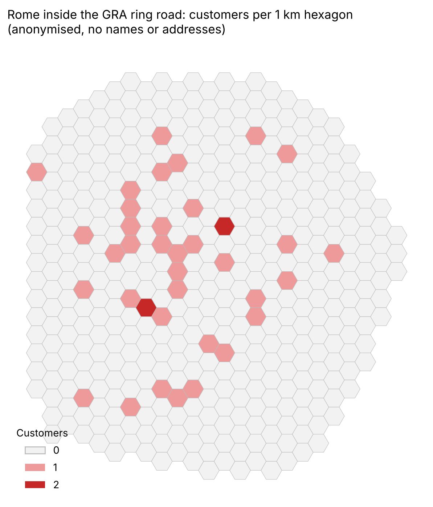

# Customer distribution map for a small business in Rome (anonymised)

Business GIS case study: turning a spreadsheet of customer addresses into maps that show **where customers are concentrated** in Rome and Lazio. Built in QGIS.

> **Privacy:** the original data are a real customer list. Names, addresses and point locations are **not published**. This repository only shows the method and an aggregated, anonymised result.

## Task

The client asked for a map of their **59 customers** (pharmacies) based **only on names and street addresses**. Sales data were explicitly excluded from the analysis.

## Method

1. **Data cleaning:** spreadsheet of names and addresses → standardised address strings.
2. **Geocoding:** batch geocoding with Nominatim (OpenStreetMap), manual check of failed or misplaced points (e.g. homonymous streets in other municipalities).
3. **Projection:** WGS 84 / UTM 33N (EPSG:32633), so that distances and cell sizes are in metres.
4. **Density:** kernel heatmap (radius in metres, map units) to see the hot spots.
5. **Hexagonal grid:** 2 km grid on the whole city, then a **1 km grid clipped to the GRA ring road** (ring road from OpenStreetMap via QuickOSM → *Polygonize*, inner area 344 km²). Points counted per cell with *Count points in polygon*.
6. **Layouts:** Rome inside the GRA, and the customers outside Rome on a Lazio map with provinces and an inset of Italy.

## Results

- 59 customers: 47 in Rome, 12 elsewhere in Lazio.
- Inside the GRA: **439 hexagons of 1 km**, 37 with at least one customer (35 with one, 2 with two). Customers are spread across the city, with a denser band west of the centre.

## Lessons learned

- A filter on attributes is not a spatial filter: a badly geocoded point ends up in the wrong place even if its address field says "Roma".
- Heatmap radius must be in **map units (metres)**, not millimetres, and points with empty geometry must be removed first.
- Always name output fields explicitly and insert them by double-click to avoid hidden trailing spaces.

## Tools

QGIS (Batch Nominatim geocoding, QuickOSM, heatmap, hexagonal grids, print layouts)

---

### 🇮🇹 In breve

Caso di studio di GIS per un'azienda: dagli indirizzi dei clienti (59 farmacie) a mappe di distribuzione su Roma e Lazio, con geocodifica, heatmap e griglie esagonali da 1 km dentro il GRA. I dati originali sono riservati: qui sono pubblicati solo il metodo e una mappa anonima e aggregata.

*Author: Pietro Bertini – October 2026*
